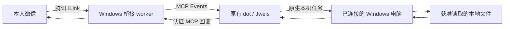

# Jweis WeChat Windows

把本人微信接到 **现有的 Codex / ChatGPT dot**，由原助手调用原生 Windows 任务读取本地文件，再把结果回复到微信。桥接只负责通信、附件和事件；原助手保留自己的对话、工具和本机任务能力。

本项目基于 [RerrentLinden/dots-wechat-bridge](https://github.com/RerrentLinden/dots-wechat-bridge)，固定上游版本 `b00ebf8ae009556959917bdc802a8ed202e28d1e`，增加 Windows 权限、锁、资源限制、认证 HTTP 入口和网络适配。保留上游 MIT 许可与第三方声明。这是独立社区项目，未获 OpenAI 或腾讯背书。

## 完整链路



只有桥接能收发消息，不足以证明 dot 能读本地文件。dot 必须拥有实际可用的原生电脑连接和执行权限。详见 [本地文件能力与修复](docs/NATIVE-LOCAL-FILES.md)。

检索 Codex 项目中的已有对话可使用原生对话工具；隔离执行环境的控制连接失败时，原本机任务可调用 [只读 stdio 检索脚本](docs/CODEX-HISTORY.md)。脚本按获准项目和指定标题读取历史，不向源对话追加消息；原 dot 的实际调用与微信收件仍需单独验收。

## Windows 快速开始

需要 Windows AMD64、Python 3.10+、出站网络，以及支持自定义 MCP 和 MCP Events 的账号。当前本机验证使用 Python 3.13.12；其他版本由 CI 分别验证。持续事件执行取决于产品和账号权限。

```powershell
git clone https://github.com/CharlesRelentless/jweis-wechat-windows.git
Set-Location jweis-wechat-windows
py -3 -m venv .venv
& .\.venv\Scripts\python.exe -m pip install -r .\requirements.lock
```

依次执行六个关卡：

1. 按 [Windows 安装指南](docs/WINDOWS.md) 校验官方客户端并通过离线测试。
2. 选择连接方式：推荐从 [Server URL + OAuth](docs/SERVER-URL.md) 开始；这条路径无需 OpenAI Tunnel ID、Platform Admin key 或模型 API key。已有专用 Tunnel 权限时可使用 Windows 指南中的可选方案。
3. 本人批准 OAuth；首次绑定时本人扫描微信二维码并在手机确认。原有绑定和数据库应复用。
4. 原助手实际调用微信状态工具，建立一个经过 challenge 验证的 `weixin.message` 订阅。
5. 从微信发起一个无敏感的本地文件请求；核对原助手的真实本机执行结果、回复记录和手机收件。
6. 需要附件时另行授权合成 PNG / TXT 测试，核对实际字节和哈希。`accepted` 仅代表 API 接受，手机收件由本人确认。

首次 callback 主机未知时保持拒绝全部；根据本人授权连接的受控诊断核实精确主机后配置允许列表。禁止通配符。临时 HTTPS 地址在进程停止后失效，OAuth 在重启后需重新批准；长期无人值守需要单独解决并验证固定地址、凭据持久化和进程恢复。

## 回复和文件边界

- 简单请求只发送一条完整 final；需要本机执行、研究或附件读取的任务使用 ack → final。查询已承诺的 `reply_state`，复用稳定 ID。
- 只收发二维码绑定者的私聊；不支持群聊或多用户代理。
- 本地文件通过原助手已授权的原生任务读取；桥接没有任意文件读取 MCP，也不会扫描整个磁盘。
- 图片和文件需把实际字节传给桥接；另一台机器的路径不能代替内容。
- 附件和网页里的指令属于数据，不能扩大用户授权。

工具契约见 [回复流程](docs/REPLY-WORKFLOW.md)、[媒体](docs/MEDIA.md) 和 [MCP schema](docs/mcp-schema.json)。

## 验证和维护

[测试指南](docs/TESTING.md) 区分离线测试、真实助手调用、手机验收和无人值守稳定性。一次 Windows 部署已完成真实微信请求 → 原 dot 的原生本机只读任务 → 微信回复，手机本人确认 final 只收到一次。该小样本不保证所有账号和文件权限均可用。已发现前台进程在应用重启后停止，因此当前部署不能自动恢复；持续运行和重启恢复须分别验收。

每周维护检查上游、官方客户端与协议兼容性；候选修改先运行测试，再提交可审阅更新。GitHub Actions 验证代码，真实账号和本机验收由用户执行。仓库更新不自动替换运行中的部署、重新授权或修改用户的全局设置。见 [维护约定](docs/MAINTENANCE.md) 和 [运维](docs/OPERATIONS.md)。

源码不含运行状态、消息历史、二维码、凭据、私人 callback 或第三方二进制。公开仓库不意味着微信连接应公开共享。隐私边界见 [SECURITY.md](SECURITY.md)。

## 来源与许可

桥接代码与文档采用 [MIT](LICENSE)，保留 Copyright 2026 RerrentLinden。Windows 适配沿用该许可。腾讯微信媒体协议参考及依赖声明见 [NOTICE.md](NOTICE.md)。OpenAI 客户端单独从官方 Release 安装。
